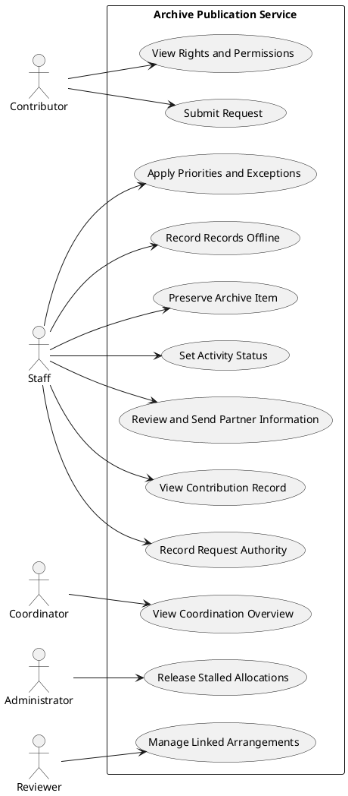

# From Requirements to User Stories

## Supplied Requirements

| ID | Functional Requirement | Priority | Source |
|---|---|---|---|
| FR01 | The system shall allow staff to view information about a contribution through a single record. | Should | Staff (SKH3), INS1 |
| FR02 | The system shall allow a contributor to view rights and permissions confirmation of submitted material. | Should | Contributor (SKH1), INS2 |
| FR03 | The system shall allow staff to verify third party authorisation before a request's information is disclosed | Must | Staff (SKH3), INS3 |
| FR04 | The system shall allow a contributor to submit a request through a single point of entry for publication. | Must | Contributor (SKH1), INS4, INS9 |
| FR05 | The system shall allow staff to apply priorities and exceptions to requests. | Must | Staff (SKH3), INS5 |
| FR06 | The system shall allow an administrator to view blocked capacity and release stalled requests. | Should | Administrator (SKH8), INS6 |
| FR07 | The system shall allow reviewers to view dependencies between linked arrangements. | Could | Reviewer (SKH9), INS7 |
| FR08 | The system shall allow staff to access records off-site when connectivity is unreliable. | Should | Staff (SKH3), INS8 |
| FR09 | The system shall allow staff to preserve an item in the archive without approving it for public access| Must | Staff (SKH3), INS1 |
| FR10 | The system shall allow staff to set an activity status on a request from the agreed standard terms. | Must | Staff (SKH3), INS9 |
| FR11 | The system shall allow staff to send external partners only the information required for their role. | Must | Staff (SKH3), External partners (SKH4), INS3 |
| FR12 | The system shall show coordinators unallocated requests, provisional allocations, capacity conflicts, overdue actions and incomplete records. | Must | Coordinator (SKH2), INS1, INS6 |


## Task 1: Develop User Stories

| Story ID | Requirement | Role-Goal-Benefit user story|
|---|---|---|
|UC01|FR01|As a staff member, I want to view information about a contribution through a single shared record, so I do not have to search across separate records
|UC02|FR02|As a contributor, I want to view rights and permissions of my submitted material to ensure they are correct
|UC03|FR03|As a staff member, I want to record the authority of each request before third parties are involved, so that they are only involved with the right authority in place
|UC04|FR04|As a contributor, I want to submit my material for publication, so that I can start a request and check its status
|UC05|FR05|As a staff member, I want to apply the agreed priorities and exceptions to requests, so that requests are handled consistently
|UC06|FR06|As an administrator, I want to view blocked capacity and release stalled requests, so that the capacity for new requests is increased
|UC07|FR07|As a reviewer, I want to view the dependencies between linked arrangements, so that I can understand the impact of a change  on related arrangements before making it
|UC08|FR08| As a staff member, I want to access records off-site when connectivity is unreliable, so that I can keep working on requests
|UC09|FR09|As staff member, I want preserve an item in the archive, so that it can be kept safely until it is  released|
|UC10|FR10|As a staff member, I want to set the activity status of request using the agreed standard terms, so that everyone working on the request has a consistent understanding of its current progress
|UC11|FR11|As a staff member, I want to send external partners only the information required by their role, so that they receive what they need without unnecessary case history
|UC12|FR12|As a coordinator, I want to view unallocated requests, provisional allocations, capacity conflicts, overdue actions and incomplete records, so that I can coordinate requests and capacity

<br>

## Task 2: Acceptance Criteria

### Selected User Story: UC01

> As a staff member, I want to view information about a contribution through a single shared record, so I do not have to search across separate records

#### Acceptance Criteria

| ID | Observable acceptance condition |
|---|---|
|A1 |The staff member is authenticated before viewing the record |
|A2 |Searching for a contribution returns only one record|
|A3 |The record shows the current status, review stage, and ownership status of the contribution|
|A4 |An update made by one staff member is visible to other staff members viewing the same record|
|A5|Earlier versions of the record remain visible when new information is added|
|A6|A staff member can find all the information about a contribution without opening any other record|

#### Given When Then

```gherkin
Given a contribution has been submitted
And the contribution has a current activity status, review stage, and ownership recorded
When an authenticated staff member views the contribution's record
Then the record shows the current activity status
And the record shows review stage
And the record shows the ownership status
```

#### Questions Revealed

1. Which staff member can view and edit the record
2. What is the minimum information required for a contribution before it's accepted and viewable in the system
3. Can a contribution be viewed before it has been allocated?
4. How much history is shown for the record, and is older history archived after a certain period?

<br><br>

### Selected User Story: UC02
> As a contributor, I want to view rights and permissions of my submitted material to ensure they are correct

#### Acceptance Criteria

| ID | Observable acceptance condition |
|---|---|
|A1 |The contributor is authenticated before viewing rights and permissions |
|A2|Each contribution by the contributor has rights and permissions recorded in the system|
|A3| The contributor can see the rights and permissions of each item they have submitted|
|A4|When a staff member updates an item's rights and permissions, the contributor can see the updated changes|
|A5| The contributor cannot see the rights and permissions of material submitted by another contributor|


#### Given When Then

```gherkin
Given the contributor is authenticated
And the contribution exists in the system
And the contribution has rights and permissions recorded
When a contributor views their contribution
Then the rights and permissions of their contribution are shown
And the rights and permissions of other contributors material are now shown
```

#### Questions Revealed

1. Can a contributor see the full rights and permissions record? or only a summary of it?
2. If the contributor thinks the rights or permissions are wrong, how do they raise a correction, and who handles it?
3. Should a contributor see internal staff notes that explain why a right status was set
4. Can a contributor see rights and permissions for material they co-own with another contributor, or only for items where they are the sole owner?

<br><br>

### Selected User Story: UC03

>  As a staff member, I want to record the authority of each request before third parties are involved, so that they are only involved with the right authority in place

#### Acceptance Criteria

| ID | Observable acceptance condition |
|---|---|
|A1 |The staff is authenticated before recording authority|
|A2 |The staff member can record authority required for a request, including who may act for the requester|
|A3 |A third party cannot be assigned a request until its authority has been recorded|
|A4 |Attempting to assign a third party to a request with no recorded authority shows a message that authority must be recorded first|
|A5 |The recorded authority is shown on the request and visible to staff working on it|
|A6 |Changing the recorded authority keeps the earlier entry visible in the request's history|

#### Given When Then

```gherkin
Given the staff member is authenticated
And a request exists with no authority recorded
When the staff member attempts to assign a third party to the request
Then the third party is assigned to the request
And the authority is visible to other staff members
And assignment of the authority is stored in the request's history
```

#### Questions Revealed

1. Can a request be assigned to more than one third party, and does it need separate authority
2. What level or role should a staff member have to record authority
3. Can authority expire and if so how does the system handle it
4. What happens to an already assigned third party if authority is changed or revoked

<br><br>

### Selected User Story: UC04

> As a contributor, I want to submit my material for publication, so that I can start a request and check its status

#### Acceptance Criteria

| ID | Observable acceptance condition |
|---|---|
|A1 |An allocation is open to receive a request |
|A2 |The contributor supplies information for the request|
|A3 |The request is recorded in the system |
|A4 |The contributor sees the request has been received|
|A5 |A request with insufficient information is shown not ready for publication| 
|A6 |The status of a request is visible to the contributor 

#### Given When Then

```gherkin
Given an allocation is open to receive a request
When the contributor enters the required details and attaches the material
Then the request is recorded in the system
And the contributor is shown a confirmation that the request has been received
And the contributor can see the current status of the request
```


#### Questions Revealed

1. How is a request handled if no allocation is available
2. Is there a minimum amount of information required for a request to be recorded
3. How is a request handled if there's insufficient information
4. How can a contributor track the request? through tracking number?
5. How does the system handle duplicate requests

<br><br>

### Selected User Story: UC05

> As a staff member, I want to apply the agreed priorities and exceptions to requests, so that requests are handled consistently

#### Acceptance Criteria

| ID | Observable acceptance condition |
|---|---|
|A1 |The staff is authenticated to apply priorities and exceptions |
|A2 |The system allows staff to apply a priority to a request from the agreed priorities|
|A3 |An exception can be applied only with a recorded reason|
|A4 |The applied priority and any exceptions are visible to staff working on the request|
|A5 |Changes to a request's priority are recorded in the request history, including who made the changes and when


#### Given When Then

```gherkin
Given the staff is authenticated to apply priorities and exceptions to a request
When the staff attempts to apply a priority or exception
Then the system provides the agreed priorities to apply
And the priority is recorded in the request's history
And the priority or exception is visible to other staff members working on the request
```

#### Questions Revealed

1. What determines priority? submission date, urgency, request type or another factor
2. What exceptions are permitted, and who can approve them
3. How does the system handle two requests with the same priority
4. Does reason for an exception need to be recorded whenever an exception is applied or changed

<br><br>

### Selected User Story: UC06

> As an administrator, I want to view blocked capacity and release stalled requests, so that the capacity for new requests is increased

#### Acceptance Criteria

| ID | Observable acceptance condition |
|---|---|
|A1 |The administrator is authenticated |
|A2 |The administrator can view the current blocked and stalled requests|
|A3 |The administrator can view the details and current status of a stalled request before releasing it|
|A4 |The administrator can release the stalled request
|A5 |The system updates the available capacity to reflect the release
|A6 |The system shows a confirmation message that the request has been released and capacity made available


#### Questions Revealed

1. What level of detail can the administrator see about the request
2. What defines a stalled request
3. What does releasing a stalled request mean?, cancel, remove, or return capacity to the available pool
4. How is blocked capacity calculated

<br><br>

### Selected User Story: UC07

> As a reviewer, I want to view the dependencies between linked arrangements, so that I can understand the impact of a change on related arrangements before making it

#### Acceptance Criteria

| ID | Observable acceptance condition |
|---|---|
|A1 |The Reviewer is authenticated to view and make changes |
|A2 |The reviewer can view the linked arrangements to a selected arrangement|
|A3 |The system shows the affected linked arrangements if a change is proposed
|A4 |The system confirms the change and display the impacted linked arrangements 


#### Questions Revealed

1. What qualifies as a linked arrangement
2. How should dependencies be displayed, list, diagram, relationship map

<br><br>

### Selected User Story: UC08

> As a staff member, I want to access records off-site when connectivity is unreliable, so that I can keep working on requests

#### Acceptance Criteria

| ID | Observable acceptance condition |
|---|---|
|A1 |staff member can record progress off site when connection is unreliable |
|A2 |The system indicates when the staff member is working offline|
|A3 |Changes are saved locally until connectivity is restored|
|A4 |When connection returns locally saved changes are synchronised in the shared record|


#### Questions Revealed

1. Which records are available offline and does staff need to download or synchronise before going off-site
2. How is sensitive information protected when stored on a device
3. What happens when connectivity returns? Are changes uploaded automatically and what happens if two staff members have edited the same shared record?

<br><br>

### Selected User Story: UC09

> As staff member, I want preserve an item in the archive, so that it can be kept safely until it is  released

#### Acceptance Criteria

| ID | Observable acceptance condition |
|---|---|
|A1 |Item exists in the archive |
|A2 |Staff member can preserve the item|
|A3 |Item is shown as preserved on the system


#### Questions Revealed

1. What conditions make a item applicable to preserve
2. Who has authority to view the preserved item


<br><br>

### Selected User Story: UC10

> As a staff member, I want to set the activity status of request using the agreed standard terms, so that everyone working on the request has a consistent understanding of its current progress

#### Acceptance Criteria

| ID | Observable acceptance condition |
|---|---|
|A1 |Request exists in the system |
|A2 |Staff can set activity of a request status from agreed terms|
|A3 |Activity status is visible to others staff members working on the request|


#### Questions Revealed

1. Are standard activity terms agreed by the staff or configured into the system


<br><br>

### Selected User Story: UC11

> As a staff member, I want to send external partners only the information required by their role, so that they receive what they need without unnecessary case history


#### Acceptance Criteria

| ID | Observable acceptance condition |
|---|---|
|A1 |The staff member can select and share information relevant to the partner's role |
|A2 |The information disclosed excludes sensitive data|
|A3 |The staff member can review the information being shared before sending it|


#### Questions Revealed

1. Who is responsible for ensuring sensitive information is not disclosed? the staff member, system or both?


<br><br>

### Selected User Story: UC12

> As a coordinator, I want to view unallocated requests, provisional allocations, capacity conflicts, overdue actions and incomplete records, so that I can coordinate requests and capacity


#### Acceptance Criteria

| ID | Observable acceptance condition |
|---|---|
|A1 |The coordinator can view information relevant to their roles |
|A2 |The coordinator can select unallocated requests, provisional allocations, capacity conflicts, overdue actions and incomplete record|


#### Questions Revealed

1. Is sensitive data still hidden in incomplete records

<br><br>


## Task 3: Identify Actors and Use Cases

<br>

### Actor Catalogue
| Actor or Stakeholder | Type | Goal or Interest | Direct Interaction |  
|---|---|---|---|
| Contributor | Primary Actor | Submit contributions for publication and track status | Yes |
| Coordinator | Primary Actor | See information about unallocated requests, provisional arrangements, capacity conflicts, overdue actions and incomplete records | Yes |
| Staff | Primary Actor | Process requests, set standard terms, preserve items| Yes |
| External Partners | Offstage Stakeholder | Receive relevant information required for their role | No |
| Management | Offstage Stakeholder | Receive and view summary reports on the status and outcomes of submitted items | No |
| Funders | Offstage Stakeholder | Receive appropriate summary reports without sensitive data | No |
| Third Party | Supporting Actor | Assist with processing of requests for publication | No |
| Administrator | Primary Actor | View blocked capacity and release stalled requests | Yes |
| Reviewer | Primary Actor |  Add new information without erasing information about earlier decisions | Yes |


## Use-Case Catalogue

|ID | Use Case | Primary Actor | Meaningful Outcome | Source Requirement |
|---|---|---|---|---|
| UC01 | View Contribution Record | Staff | Contribution information is displayed in a shared record without searching across separate records | FR01 |
| UC02 | View Rights and Permissions | Contributor | Can view the rights and permissions of material they have submitted | FR02|
| UC03 | Record Request Authority | Staff | Allows staff to record authority before information about a request are disclosed with third parties | FR03 |
| UC04 | Submit Request | Contributor | Allows contributor to submit material for publication | FR04 |
| UC05 | Apply Priorities and Exceptions | Staff | Requests are handled consistently by applying agreed prioriites and exceptions |  FR05| 
| UC06 | Release Stalled Allocations | Administrator | Capacity held by stalled provisional becomes available for new requests | FR06 |
| UC07 | Manage Linked Arrangements | Reviewer | Knock-on effect of linked arrangements is displayed before changes can be made | FR07 |
| UC08 | Access Records Offline | Staff | Staff can continue working on request-related tasks offline when connectivity is unreliable | Fr08 |
| UC09 | Preserve Archive Item | Staff | Item is safely retained if not approved public access | FR09 |
| UC10 | Set Activity Status | Staff | Staff share a consistent understanding of a request's status | FR10 |
| UC11 | Review and Send Partner Information |Staff | External partners receive the information needed for their role without unnecessary case history or inappropriate disclosure of sensitive information | FR11 |
| UC12 | View Coordination Overview | Coordinator |  Coordinator can view issues affecting request capacity | FR12 |

## Task 4: Use-Case Diagram

### Plant UML Code


<details>
<summary><strong>Task 4: Use-Case Diagram</strong></summary>

### PlantUML Code



</details>


## Task 5: Traceability

| Business problem or stakeholder goal | Requirement | User Story | Acceptance Evidence | Use Case |
|---|---|---|---|---|
|Contribution information is stored in different files, notes, folders, spreadsheets and messages | FR01 |UC01 | Staff can view contribution in a single shared record |View Contribution Record |
|Ownership and permissions for submitted material are not always certain| FR02 | UC02 | Contributor can see rights and permissions of their submitted material |View Rights and Permissions|
|Staff are unsure what authority is required before information or decisions can be shared#| FR03 | UC03 | Staff can record authority before information about a request are disclosed with third parties  |Record Request Authority|
|Requests arrive through several channels and may be incomplete | FR04 | UC04 | Requests arrives through a single channel |Submit Request|
|Priorities and exceptions are not applied consistently | FR05 | UC05 |Allows staff to apply agreed priority and exceptions to requests |Apply Priorities and Exceptions| 
|Provisional allocations remain in place while essential information is missing, long after the original request has stalled | FR06 | UC06 | Stalled Requests are released increasing capacity for allocations |Release Stalled Allocations |
|Changes can affect several linked arrangements | FR07 | UC07 | Shows knock-on effect of linked arrangements before changes are made | Manage Linked Arrangements |
|Connectivity may be unreliable during off-site work | FR08 | UC08 | Staff continue working on request-related tasks offline when connectivity is unreliable|Access Records Offline |
|Staff may be unclear whether an item is preserved, approved for public access, or still awaiting approval |FR09 | UC09 |Item is safely retained if not approved public access |Preserve Archive Item |
|Teams use status terms differently, and planned activities can be changed, partially completed, paused or withdrawn| FR10 |UC10 |Staff share a consistent understanding of a request's status |Set Activity Status|
|Staff are unsure what authority is required before sharing information with external partners| FR11 | UC11 |Staff can authorise and send information required by the external partner's role| Review and Send Partner Information|
|The coordinator needs information about unallocated requests, provisional arrangements, capacity conflicts, overdue actions and incomplete records | FR12 | UC12 |Coordinator can view issues affecting request capacity| View Coordination Overview|